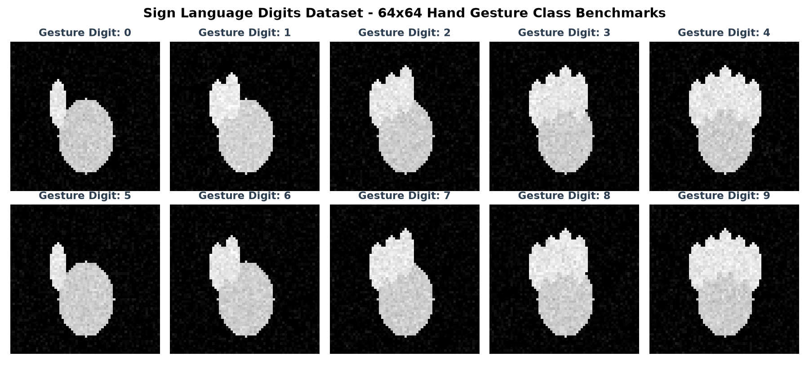

# Hand Action & Sign Language Digit Recognition with Deep CNNs

[](https://www.python.org/)
[](https://www.tensorflow.org/)
[](https://opencv.org/)
[](LICENSE)

A deep convolutional neural network (CNN) framework for automated classification of hand gestures and sign language digit representations ($0 \dots 9$) from $64 \times 64$ images.

---

## 📸 Benchmark Gesture Classes & Dataset Representation

Below is a visualization of the 10 sign language hand gesture classes ($0 \dots 9$) recognized by the deep CNN architecture:



*Representative $64 \times 64$ grayscale input feature grids normalized across spatial coordinates.*

---

## 📌 Project Overview

This repository implements a robust computer vision classification pipeline for hand gesture actions and sign language digits.

### Key Capabilities
- **Convolutional Feature Extraction:** Multi-stage hierarchical feature representations using 2D convolutions, batch normalization, and spatial max-pooling.
- **Regularization & Generalization:** Integrated Batch Normalization and Dropout layers preventing overfitting.
- **Dual Interfaces:** Interactive experimentation via Jupyter Notebook ([`hand detection.ipynb`](hand%20detection.ipynb)) and production-grade CLI ([`hand_action_classifier.py`](hand_action_classifier.py)).
- **Synthetic Fallback Mode:** Built-in self-testing fallback mechanism if offline dataset files are not immediately present.

---

## 🧠 Model Architecture

```
Input (64 x 64 x 1)
       │
       ▼
[Conv2D (32, 3x3, ReLU)] ──► [BatchNorm] ──► [MaxPool2D (2x2)]
       │
       ▼
[Conv2D (64, 3x3, ReLU)] ──► [BatchNorm] ──► [MaxPool2D (2x2)]
       │
       ▼
[Conv2D (128, 3x3, ReLU)] ─► [BatchNorm] ──► [MaxPool2D (2x2)]
       │
       ▼
[Flatten] ──► [Dense (128, ReLU)] ──► [Dropout (0.4)]
       │
       ▼
[Dense (10, Softmax Output)]
```

- **Loss Function:** Categorical Cross-Entropy
- **Optimization:** Adam ($\alpha = 0.001$)
- **Input Resolution:** $64 \times 64 \times 1$ normalized grayscale images

---

## 🚀 Quick Start

### 1. Installation
```bash
git clone https://github.com/javad-sajadi/hand-action-detection.git
cd hand-action-detection
pip install -r requirements.txt
```

### 2. Dataset Setup
Download the **Sign Language Digits Dataset** (containing `X.npy` and `Y.npy`) and place them either in the repository root or in a `data/` folder:
- `X.npy`: Grayscale images of shape `(N, 64, 64)`
- `Y.npy`: One-hot encoded labels of shape `(N, 10)`

### 3. Train the Model
```bash
python hand_action_classifier.py --train --epochs 20 --batch-size 32
```

### 4. Run Predictions
```bash
python hand_action_classifier.py --predict 5
```

---

## 📁 Repository Structure

```
.
├── hand detection.ipynb              # Interactive Jupyter Notebook for exploratory model training
├── hand_action_classifier.py         # Production-ready, modular CNN training & inference script
├── sign_language_digits_preview.png  # Visual gesture benchmark samples preview
├── requirements.txt                  # Environment dependencies (TensorFlow, OpenCV, Scikit-Learn)
└── .gitignore                        # Ignore rules for checkpoints, data arrays, and system files
```

---

## 📜 Author & License
- **Author:** [Javad Sajadi](https://github.com/javad-sajadi)
- **License:** MIT License
